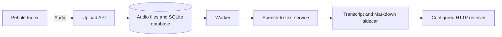

# Koebako 🎙️

**Koebako is a privacy-focused, self-hostable recorder and transcription pipeline for Pebble Index.** It stores audio locally, sends it to the speech-to-text service you configure, and delivers the transcript to a receiver you choose, such as [Koemichi](https://github.com/divin/koemichi). You control those services and where data is stored; enabling Pushover notifications also sends transcript text to Pushover. The name combines *koe* (声, “voice”) and *bako* (箱, “box”).

AI tools were used during development.

## 🧭 How it works



The API and worker are separate processes using a shared data directory and SQLite database. The worker tracks and retries transcription and delivery work; no separate queue service is required. Transcript delivery can repeat, so receivers should deduplicate using `note_id`.

## 🚀 Quick start

1. Copy `example.env` to `.env` and fill in the Pebble token, speech-to-text service, transcript receiver, and Pushover credentials (or set notifications to `off`). See [deployment and configuration](docs/deployment.md).
2. Create the host data directory and set its ownership for the UID/GID Compose will use:

   ```sh
   mkdir -p ./data
   export HOST_UID="$(id -u)" HOST_GID="$(id -g)"
   ```

3. Start the services:

   ```sh
   docker compose pull
   docker compose up -d
   docker compose logs -f api worker
   ```

The example Compose file pulls the published GHCR image; no local Docker build is needed. It maps host port `8000` to container port `8000` on all host interfaces. Pebble needs a reachable HTTPS URL, so expose only the `api` service through a reverse proxy or tunnel and protect the host with a firewall. Keep the worker private. See [deployment and configuration](docs/deployment.md) before exposing the API.

## 📥 Upload and transcript APIs

Koebako accepts authenticated multipart audio uploads at `POST /memo`, transcribes accepted recordings, then delivers versioned JSON to `TRANSCRIPT_WEBHOOK_URL`. See [API reference](docs/api.md) for fields, limits, responses, retries, and the transcript payload contract.

## 🔔 Notifications

Pushover reports upload, transcription, delivery, retry, and terminal-failure events. Normal and debug transcription notifications include the recognized transcript; debug mode adds timing/model details and quiet retry notices. Messages are truncated visibly at Pushover's 1,024-character limit. See [notifications and privacy](docs/notifications.md).

## 💾 Data and privacy

Koebako is designed to keep recordings and its database on your own host, and to let you choose the speech-to-text and transcript-receiver services. It does not make processing services private by itself: audio is sent to the configured STT service, transcripts to the configured receiver, and—when notifications are enabled—transcript text to Pushover. Back up the complete `/data` directory and choose trusted, appropriately protected services. See [data and operations](docs/deployment.md#data-and-operations).

## 🧪 Development

Use Python 3.12, [`uv`](https://github.com/astral-sh/uv), and [`just`](https://just.systems/man/en/):

```sh
uv sync --dev
just       # Format, lint, and sort imports
just check # Type, format, and lint checks
just test  # Test suite
```
